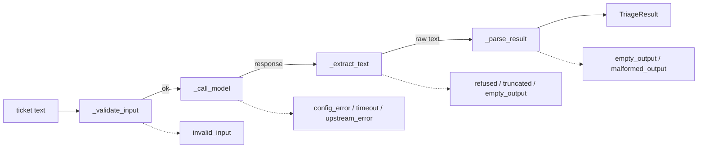

# Ticket Triage (AI-backed)

Takes a raw customer support ticket, asks Claude to triage it, and returns a
validated, typed result or an explicit, typed error. Nothing fails silently.

A support queue needs three things from a first pass: what kind of ticket it is,
how urgent it is, and whether a person must look at it before anyone replies. This
pipeline answers those in one model call and guarantees the caller either gets a
`TriageResult` that matches the contract below or a `TriageError` with a stable code.

## Quick start (Docker, no API key needed)

```bash
docker build -t ticket-triage .

# Offline demo: a canned client stands in for Claude, everything else is real.
docker run --rm ticket-triage --demo "I was charged twice for my Pro plan this month."
echo "The export button crashes the app every time." | docker run --rm -i ticket-triage --demo

# Test suite and lint, fully offline.
docker run --rm --network none --entrypoint python ticket-triage -m pytest -q
docker run --rm --network none --entrypoint ruff ticket-triage check .
```

To triage with Claude, copy `.env.example` to `.env`, set `ANTHROPIC_API_KEY`, and run:

```bash
docker run --rm --env-file .env ticket-triage "I was charged twice for my Pro plan this month."
```

## Local setup

Python 3.12 (pinned in `.python-version`).

```bash
python3 -m venv .venv && .venv/bin/pip install -r requirements-dev.txt

.venv/bin/python -m triage --demo "I was charged twice for my Pro plan this month."
.venv/bin/python -m pytest -q      # offline; no key needed
.venv/bin/ruff check . && .venv/bin/ruff format --check .

export ANTHROPIC_API_KEY=...       # only for real triage
.venv/bin/python -m triage "I was charged twice for my Pro plan this month."
echo "The export button crashes the app every time." | .venv/bin/python -m triage
```

The CLI prints one JSON object to stdout and exits `0` on success, `2` on invalid
input, and `1` on any other failure. With no ticket argument it reads stdin.

| Variable | Default | Purpose |
|---|---|---|
| `ANTHROPIC_API_KEY` | none | API key. The SDK also accepts `ANTHROPIC_AUTH_TOKEN` or an `ant auth login` profile. |
| `TRIAGE_MODEL` | `claude-opus-5` | Model ID, read on every call. `triage_ticket(..., model=...)` overrides it. |
| `TRIAGE_TIMEOUT_S` | `45` | Per-attempt timeout in seconds. Must be a positive number. |

## Example output

Captured from the Docker image with `--demo`:

```console
$ docker run --rm ticket-triage --demo "I was charged twice for my Pro plan this month."
{
  "ok": true,
  "result": {
    "category": "billing",
    "priority": "high",
    "summary": "Customer reports a billing problem with their account.",
    "suggested_reply": "Thanks for flagging this. A billing specialist will review your account and follow up.",
    "needs_human": true
  }
}

$ docker run --rm ticket-triage --demo "short"
{
  "ok": false,
  "error": {
    "code": "invalid_input",
    "message": "ticket text must be at least 10 characters"
  }
}

$ docker run --rm ticket-triage "I can't log in after the password reset."
{
  "ok": false,
  "error": {
    "code": "config_error",
    "message": "no API credentials; set ANTHROPIC_API_KEY"
  }
}
```

The demo's answers come from a few keyword rules in `triage/demo.py`, not from a
model. It exists to show the contract and the error paths without a key; the
canned reply still goes through the same extraction, parsing and validation as a
real one.

## Contract

**Input:** ticket text, 10–8,000 characters after trimming. Longer input is rejected, not
truncated, because a cut-off ticket could be mis-triaged.

**Success** (`triage/contracts.py` → `TriageResult`):

```json
{"ok": true, "result": {
  "category": "billing | bug | account | feature_request | other",
  "priority": "low | medium | high | urgent",
  "summary": "one sentence, ≤300 chars",
  "suggested_reply": "first reply to the customer, ≤2000 chars",
  "needs_human": true
}}
```

**Failure:** `triage_ticket` raises only `TriageError`, which has a stable `code`:

| code               | when                                                   | CLI exit |
|--------------------|--------------------------------------------------------|----------|
| `invalid_input`    | empty / too short / too long / not a string; no model call | 2 |
| `config_error`     | no API credentials, an unreadable credentials profile, key rejected (401/403), or a bad `TRIAGE_TIMEOUT_S` | 1 |
| `timeout`          | model didn't respond within `TRIAGE_TIMEOUT_S` (after 1 retry) | 1 |
| `upstream_error`   | network, rate limit, other 4xx/5xx from the API        | 1 |
| `refused`          | `stop_reason == "refusal"`                             | 1 |
| `truncated`        | `stop_reason == "max_tokens"`                          | 1 |
| `empty_output`     | no text block, whitespace only, or blank summary/reply | 1 |
| `malformed_output` | not JSON, or fails `TriageResult` validation           | 1 |

## Flow (`triage/pipeline.py`)



Each step either returns a value for the next step or raises `TriageError`. The
prompt lives in `triage/prompt.py`, and settings are read when a ticket is triaged,
not at import, so a bad value becomes a `config_error` rather than a traceback.

## Design decisions

- **Structured outputs + our own validation.** The API is constrained with a JSON
  schema (`output_config.format`), and the output is still validated with Pydantic,
  because it enforces length limits and catches any contract drift. A test keeps the
  API schema and the Pydantic model in sync.
- **Prompt-injection hygiene.** The ticket is wrapped in `<ticket>` tags, and the
  system prompt says to treat its contents as data.
- **`needs_human` flag.** The model escalates anything involving money, security,
  legal matters, or uncertainty, so an automatic reply is never the only safeguard.
- **Injectable client.** `triage_ticket(text, client=...)` lets tests swap in a fake
  client to cover every failure path deterministically. The `--demo` flag uses the
  same seam.
- **Low effort.** This is a classification task, so `effort: "low"` keeps it fast
  and cheap.
- **Credentials are configuration.** A missing, unreadable or rejected credential
  is a `config_error`, because retrying will not fix it; only network, rate-limit
  and server failures are `upstream_error`.

## Tests

All tests run offline, with no API key.

- `tests/test_pipeline.py` covers every error code with a fake client, plus the
  settings and the schema drift guard.
- `tests/test_sdk_wire.py` sends requests through the real `anthropic` client over
  an in-memory `httpx2` transport. It checks the headers and body the SDK actually
  sends (API version `2026-10-21`, `output_config`, no sampling parameters) and
  how real 401, 529 and refusal responses map to error codes.
- `tests/test_cli.py` covers the CLI exit codes, stdin input and the demo rules.

## Not done (time-boxed)

- HTTP endpoint (the pipeline is transport-agnostic; a FastAPI wrapper would map
  `invalid_input` to 422 and the other codes to 502/504).
- Eval set of labelled tickets to measure triage accuracy.
- Server-side refusal fallbacks to a second model.

## License

MIT, see `LICENSE`.
